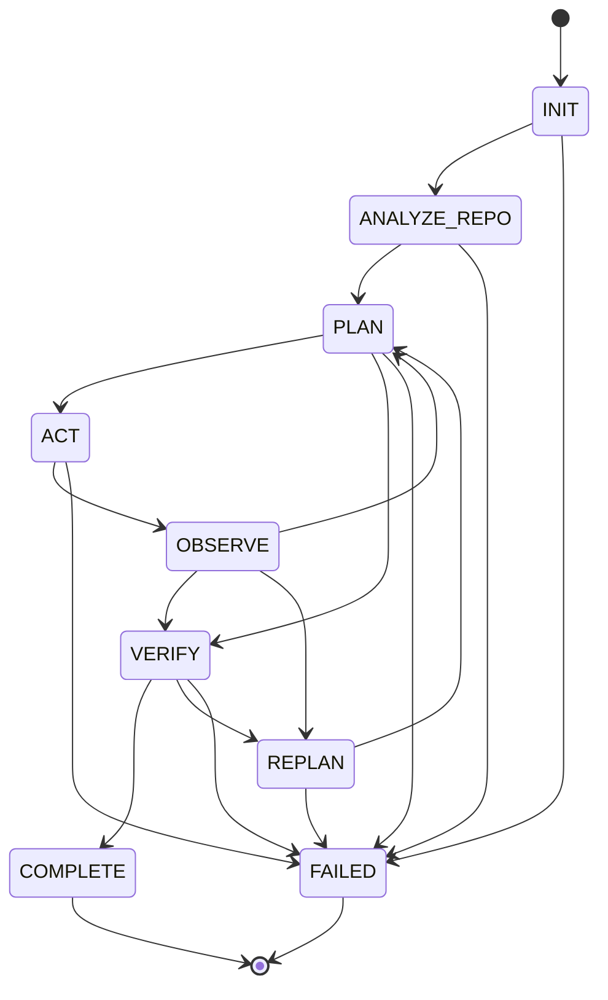

# repo-engineer: Architecture

## System overview

The runtime is a deterministic state machine; the planner (scripted recipes or
a live LLM) only proposes actions. Every proposal passes through the same
gates before execution: tool-schema validation, the permission policy, the
path jail on declared path arguments, and, for `run_tests`, the command check.
Completion requires the runtime's own verification run.



These are exactly the edges in `state.TRANSITIONS`. A failing `run_tests`
with no replans left goes OBSERVE -> REPLAN -> FAILED; there is no direct
OBSERVE -> FAILED edge.

## Module map

| Module | Responsibility | Key exports |
|---|---|---|
| `state.py` | States, legal transitions, serializable agent state, budgets | `State`, `TRANSITIONS`, `StateMachine`, `AgentState`, `ToolCall`, `Observation` |
| `tools.py` | Tool schemas, validation, permission policy, central jailing, protected paths, `run_tests` command check, verification run | `ToolRegistry`, `ToolSpec`, `Permission`, `Policy`, `Verification` |
| `jail.py` | Lexical path rules, applied before any filesystem access | `path_components`, `JailViolation` |
| `process.py` | Child environment allowlist, bounded output, process-tree kill | `run_bounded`, `child_env` |
| `redaction.py` | Removes credential values and absolute host paths from output | `Redactor` |
| `snapshot.py` | Starting snapshot of the workspace for `git_diff` and restores | `WorkspaceSnapshot` |
| `planner.py` | Action proposal: deterministic recipes, prompt-parsed LLM fallback, recorded replay | `Planner`, `ScriptedPlanner`, `LLMPlanner`, `RecordedPlanner` |
| `llm_provider.py` | OpenAI-compatible chat client (stdlib only) | `OpenAICompatProvider`, `LLMResponse` |
| `agent.py` | The runtime loop, planner feedback, trace export | `AgentRuntime`, `prepare_workspace` |
| `benchmark/harness.py` | Task suite runner and golden results | `run_benchmark`, `load_tasks` |
| `benchmark/live.py` | Live-planner runs, k attempts, never overwritten | `run_live_benchmark` |
| `sandbox/` | Where pytest and external tool servers run: Docker and local backends | `Sandbox`, `DockerSandbox`, `LocalSandbox`, `select_sandbox` |
| `schema.py` | Tool JSON Schemas and the subset validator for external tools | `ToolSchema`, `validate_json_schema` |
| `models/` | Provider adapters with native tool calling and one retry policy | `create_adapter`, `ModelAdapter`, `ProviderError` |
| `native_planner.py` | The default model-backed planner (native tool calls, finish tool, compaction) | `NativeToolPlanner` |
| `repo_map.py`, `patch.py`, `context.py` | Symbol index and repo map, strict unified diffs, context budget | `SymbolIndex`, `parse_patch`, `compact` |
| `mcp_server.py`, `mcp_tools.py` | The registry over MCP, and external MCP servers mounted through the sandbox | `build_server`, `ExternalTools` |
| `trace.py`, `replay.py` | Streamed JSONL audit trace, workspace digest, prices; offline replay | `TraceWriter`, `replay` |
| `cli.py` | The `repo-engineer` command | `main` |
| `benchmark/jail_attacks.py` | Adversarial tool calls and their recorded outcomes | `run_attacks` |

## Tool call pipeline

```
planner proposal (ToolCall)
  -> known tool?                         no -> rejected Observation
  -> schema valid (types, ranges, caps)? no -> rejected Observation
  -> permission policy?                  DENY / unapproved ASK -> rejected Observation
  -> jail declared path and glob args    escape, alias, link -> rejected Observation
     (writes: not .git, not a pytest     read-only target -> rejected Observation
      control file, not task-protected)
  -> run_tests only: command check       other command, flag or path -> rejected Observation
  -> execute
  -> Observation(ok, exit_code, redacted output_excerpt | error, latency)
```

Path arguments are declared on each `ToolSpec` (`path_args`, `glob_args`) and
jailed in `execute()` before the tool function runs, so a new tool cannot
forget the jail. The jail first validates the text (no absolute, rooted, UNC,
device or drive paths, no `..` above the root, no `:` in a component, no
trailing dot or space, no reserved device names, no `.git`) and only then
joins the path to the workspace and requires the result to be its own real
path, which refuses links and junctions. The `run_tests` command check runs
inside the tool, still before any process starts.

Rejected calls never crash the runtime; they are recorded in the trace and fed
back to the planner as history. An OS-level failure after a call was allowed
(a locked file, say) is reported as `ok=False` but not as a rejection.

## run_tests

The planner's command must be `python -m pytest` followed by allowlisted flags
(`-q`, `-v`, `-x`, `-s`, `-l`, `-r<chars>`, `--tb=<style>`, `--maxfail=<n>`,
`--capture=<method>`, `--no-header`, `-k <expr>`, `-m <expr>`) and test paths
that exist inside the workspace. The runtime builds the real argv:

```
sys.executable -P -m pytest -p no:cacheprovider -c <workspace config or os.devnull>
    --rootdir=<workspace> --confcutdir=<workspace> -o pythonpath=<workspace ...>
    <checked flags and paths>
```

Test paths reach pytest as `./<path>`, so a file named like an option or an
argument file (`--co`, `@args`) is never read as one. Every run also gets
per-run scratch space outside the workspace: a fresh `PYTHONPYCACHEPREFIX`
(bytecode planted in the workspace is never read) and pytest's `--basetemp`.
The child gets an environment allowlist (PATH, temp and home directories,
locale and a few fixed settings; no API keys, no user-name variables, no
PYTHONPATH, no PYTEST_ADDOPTS),
a deadline after which the whole process tree is killed (a job object on
Windows, the process group on POSIX), and a bounded output buffer. All of
this is the local sandbox; where the code the tests execute runs is decided by
the `Sandbox` the registry was given (`sandbox/`). Under the Docker sandbox it
runs in a fresh container with the workspace read-only and no network; under
the local sandbox it runs as the host user. See `docs/design/step2.md` for the
backends, their limits and the threat model.

## Verification rule

`COMPLETE` is reachable only from `VERIFY`. In VERIFY the runtime:

1. restores the task's protected paths and every pytest control file from the
   starting snapshot whatever their size, and deletes control files, links and
   `__pycache__` directories created during the run;
2. runs the task's `verify_cmd` with a JUnit report written outside the
   workspace;
3. passes only when the exit status is 0 and the report shows at least one
   passing test and no failures or errors;
4. for tasks that declare `mutants`, applies each one to its pristine file,
   re-runs the suite and requires it to fail;
5. for tasks that declare `neutral_edits`, applies each behaviour-preserving
   edit the same way and requires the suite to still pass, which rejects
   tests that only pin the source text.

Before and after every mutant or neutral-edit run the restore step runs
again, so nothing planted by test code in one run steers the next. A failure
inside verification (a file that cannot be restored, say) ends the run as a
failed verification rather than crashing it.

A planner claiming success changes nothing. A failed verification goes to
REPLAN with the reason and the end of the test output, until the replan
budget is exhausted, then `FAILED`.
